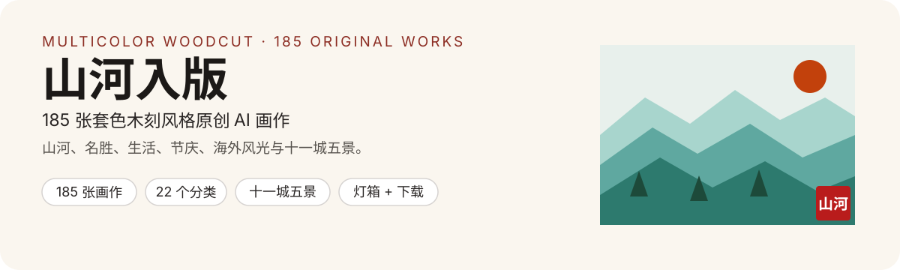
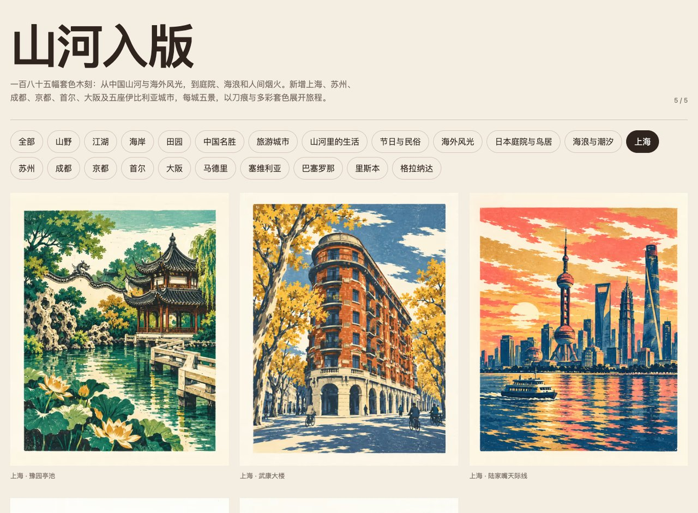
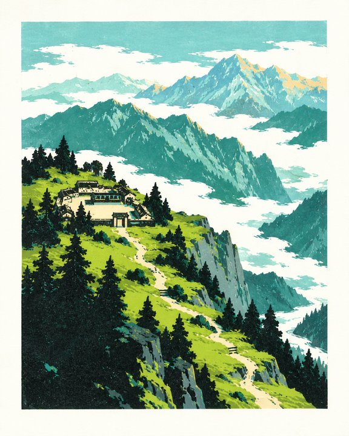

<p align="right"><a href="README.md">中文</a></p>

<p align="center">
  
</p>

<p align="center">
  <a href="https://shanhe-gallery.xiaosang.cc/">▶ Browse Online</a>
  ·
  <a href="https://github.com/holynova/shanhe-gallery">GitHub Repository</a>
</p>

An accessible gallery of 185 original AI-generated multicolor woodcut-style artworks: landscapes, landmarks, everyday life, festivals, overseas scenery, and five scenes from each of eleven cities. Carved linework, layered colors, paper texture. Category filters, keyboard navigation, a full-screen lightbox, and downloads. Originals live in `incoming/`; exact prompts in `prompts.json`.

## Screenshots

<p align="center">
  
</p>

<p align="center">
  
</p>

## Contents

- **185 works, 22 collections**: 山野 (Mountains & Fields) 5, 江湖 (Rivers & Lakes) 5, 海岸 (Coasts) 5, 田园 (Countryside) 5, 中国名胜 (Chinese Landmarks) 20, 旅游城市 (Travel Cities) 20, 山河里的生活 (Life in the Landscape) 20, 节日与民俗 (Festivals & Folk Customs) 20, 海外风光 (Overseas Scenery) 20, 日本庭院与鸟居 (Japanese Gardens & Torii) 5, 海浪与潮汐 (Waves & Tides) 5, plus 5 works from each of 11 cities.
- **Eleven cities, five scenes each** (55 works): Shanghai, Suzhou, Chengdu, Kyoto, Seoul, Osaka, Madrid, Seville, Barcelona, Lisbon, Granada — city batches avoid repeating landmarks from earlier batches.
- **Life series** (20 works): five each for morning, journey, dusk, and night — a day's journey unfolded.
- **Festival series** (20 works): festival scenes including Spring Festival, Lantern Festival, Qingming, Dragon Boat Festival, Qixi, Mid-Autumn Festival, Double Ninth, Laba, Little New Year, Winter Solstice, Water-Splashing Festival, Torch Festival, and Tibetan New Year.
- **Japanese gardens** (5 works): dry landscape (枯山水), pond-stroll garden (池泉回游), autumn maple tea garden (秋枫茶庭), torii in the sea (海上鸟居), forest approach (林间参道); fictional stylized scenes, not labelled as real temples or shrines.
- **Each 1122×1402**; all 185 originals have unique SHA-256 hashes; generation and verification records in `GALLERY.md`.

## Features

- **Browse by collection**: 22 collections, one-tap filtering, 24 works per batch.
- **Fullscreen lightbox**: each detail image shown whole at once (contain fit), keyboard navigation, Esc closes and restores focus.
- **Download & share**: per-work download and sharing both enabled; analytics off.
- **Accessibility**: no horizontal overflow at 390px, zero console errors (see the release verification record in `GALLERY.md`).

## Run Locally

```sh
npm ci
npm run build
npm run preview -- --host 127.0.0.1 --port 4327
```

Check and test:

```sh
npm run check
npm test
```

## Tech

- Astro 7 + TypeScript + sharp + zod; a three-step build — `ingest` (generate derivatives) → `validate` (verify) → `astro build` — with 7 vitest tests.
- Responsive derivatives: thumbnails at 480/768px, detail images at 960/1440/1920px, in AVIF / WebP / JPEG; 2,775 derivative files from 185 works; original PNGs never ship to dist.
- Analytics off by default (`analytics.enabled: false`).

```
incoming/               185 original PNGs (1122×1402)
prompts.json            All exact generation prompts (including edit prompts)
src/data/images.json    185 image metadata records: title, collection, alt text
src/data/collections.json  22 collection definitions
src/data/manifest.json  Derivative manifest
scripts/                ingest.ts / validate.ts
GALLERY.md              Generation and verification records (by batch)
```

## License

MIT, see `LICENSE`.
