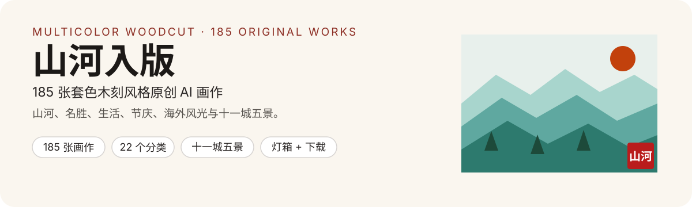
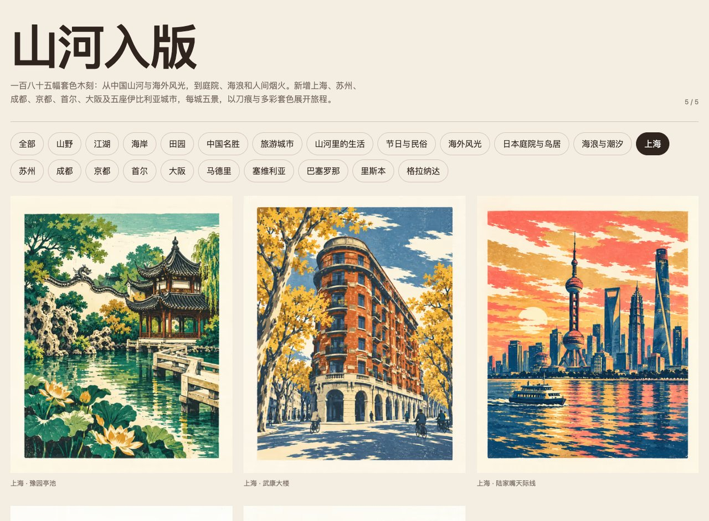
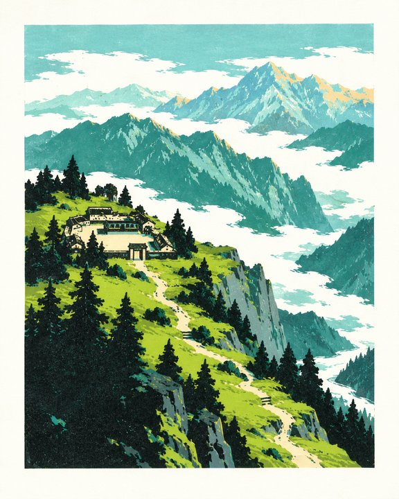

<p align="center">
  
</p>

<p align="center">
  <a href="https://shanhe-gallery.xiaosang.cc/">▶ 在线浏览 View Online</a>
  ·
  <a href="https://github.com/holynova/shanhe-gallery">GitHub 仓库</a>
</p>

185 张套色木刻风格原创 AI 画作：山河、名胜、生活、节庆、海外风光与十一城五景。木刻刀痕、套色、纸张肌理，颜色多样变化；支持分类浏览、全屏灯箱、键盘切换与下载。原图在 `incoming/`，准确提示词在 `prompts.json`。

An accessible gallery of 185 original AI-generated multicolor woodcut-style artworks: landscapes, landmarks, everyday life, festivals, overseas scenery, and five scenes from each of eleven cities. Carved linework, layered colors, paper texture. Category filters, keyboard navigation, a full-screen lightbox, and downloads. Originals live in `incoming/`; exact prompts in `prompts.json`.

## 截图 / Screenshots

<p align="center">
  
</p>

<p align="center">
  
</p>

## 内容 / Contents

- **185 张，22 个分类**：山野 5、江湖 5、海岸 5、田园 5、中国名胜 20、旅游城市 20、山河里的生活 20、节日与民俗 20、海外风光 20、日本庭院与鸟居 5、海浪与潮汐 5，另加 11 城各 5 张。
- **十一城五景**（55 张）：上海、苏州、成都、京都、首尔、大阪、马德里、塞维利亚、巴塞罗那、里斯本、格拉纳达；城市批次避免与前批景点重复。
- **生活组**（20 张）：清晨、途中、暮色、夜里各 5 幅，展开一天的旅程。
- **节日组**（20 张）：春节、元宵、清明、端午、七夕、中秋、重阳、腊八、小年、冬至、泼水节、火把节、藏历新年等节庆场景。
- **日本庭院**（5 张）：枯山水、池泉回游、秋枫茶庭、海上鸟居、林间参道；虚构风格场景，不标注真实寺院或神社。
- **每张 1122×1402**，185 张原图 SHA-256 全部唯一；生成与验证记录见 `GALLERY.md`。

## 功能 / Features

- **分类浏览**：22 个分类一键过滤，每批加载 24 张。
- **全屏灯箱**：详情图一次看到整张（contain 完整显示），键盘切换，Esc 关闭并归还焦点。
- **下载与分享**：单张下载与分享均已开启；统计关闭。
- **无障碍**：390px 无横向溢出，控制台零错误（发布验证记录见 `GALLERY.md`）。

## 本地运行 / Run Locally

```sh
npm ci
npm run build
npm run preview -- --host 127.0.0.1 --port 4327
```

校验与测试：

```sh
npm run check
npm test
```

## 技术 / Tech

- Astro 7 + TypeScript + sharp + zod；`ingest`（生成衍生图）→ `validate`（校验）→ `astro build` 三步构建，7 项 vitest 测试。
- 响应式衍生图：缩略图 480/768px、详情图 960/1440/1920px，AVIF / WebP / JPEG 三格式；185 张共 2,775 个衍生文件，原始 PNG 不进入 dist。
- 统计默认关闭（`analytics.enabled: false`）。

```
incoming/               185 张原始 PNG（1122×1402）
prompts.json            全部准确生成提示词（含编辑提示词）
src/data/images.json    185 条图片元数据：标题、分类、alt 说明
src/data/collections.json  22 个分类定义
src/data/manifest.json  衍生图清单
scripts/                ingest.ts / validate.ts
GALLERY.md              生成与验证记录（分批）
```

## English

**Shanhe Gallery** — 185 original AI-generated multicolor woodcut-style artworks: carved linework, layered colors, paper texture.

- **185 works, 22 collections**: mountains, rivers, coasts, fields (5 each); Chinese landmarks, travel cities, daily life, festivals, overseas scenery (20 each); Japanese gardens, ocean waves (5 each); plus 11 cities × 5 scenes.
- **Eleven cities** (55 works): Shanghai, Suzhou, Chengdu, Kyoto, Seoul, Osaka, Madrid, Seville, Barcelona, Lisbon, Granada — no repeated landmarks across batches.
- **Browse**: 22 category filters, batches of 24; fullscreen lightbox shows the whole image at once, keyboard navigation, Esc to close with focus restored.
- **Download & share**: both enabled; analytics off.
- **Run it**: `npm ci && npm run build && npm run preview -- --host 127.0.0.1 --port 4327`. Check with `npm run check`, test with `npm test`.
- **Tech**: Astro 7 + TypeScript + sharp + zod; ingest → validate → build pipeline, 7 vitest tests; 2,775 responsive derivatives (AVIF/WebP/JPEG) from 185 originals; originals never ship to dist.

## 许可 / License

MIT，见 `LICENSE`。
